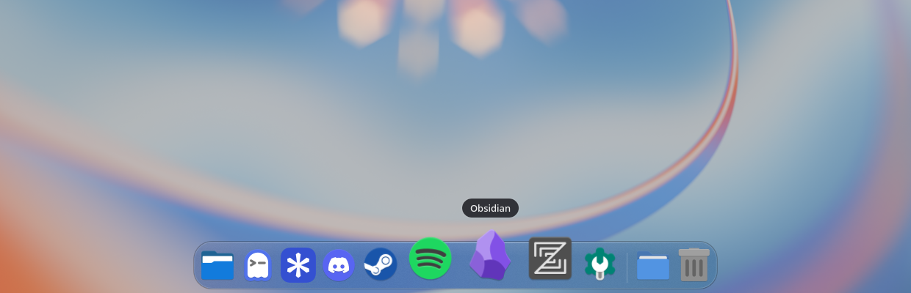
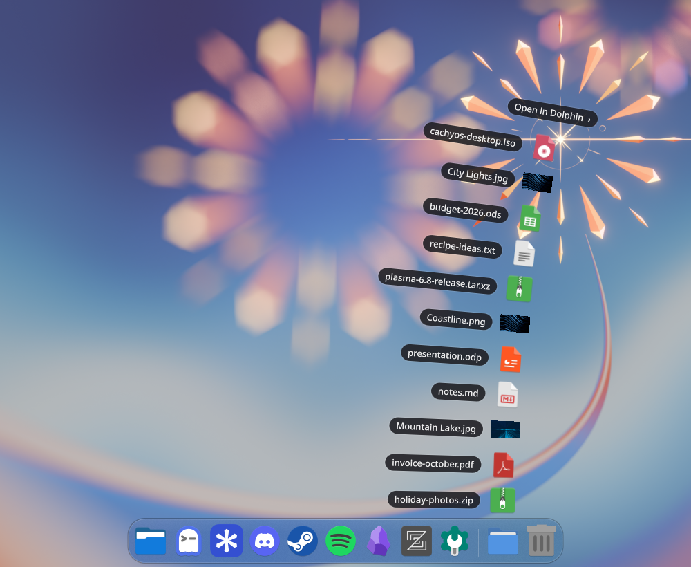
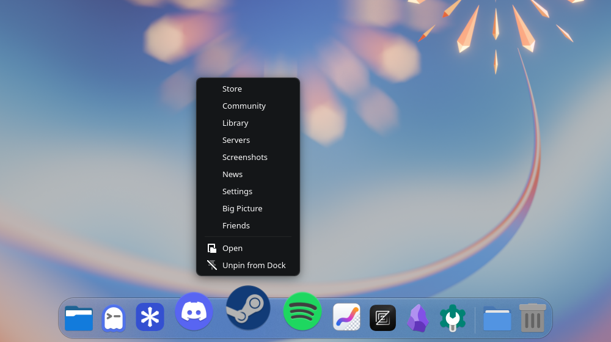

<div align="center">

# Harbour

**A macOS-style dock for KDE Plasma 6 on Wayland.**

Magnification, bouncing launches, a Genie minimise effect, stacks that fan out and glass that matches the rest of your desktop.



</div>

---

Harbour is a standalone dock written in C++20 and Qt Quick. It talks to KWin directly, using layer-shell, KWin's own screen edges and the compositor blur, so hiding, showing and blurring all happen the way the compositor expects. It aims to feel like the macOS Dock and still look at home in Plasma: your icon theme, your colour scheme and the same context menus as the rest of KDE.

## Features

- **Auto-hide that stays out of the way.** The dock slides away and comes back when you push against the bottom edge. It uses a real KWin screen edge, so it never reveals over fullscreen games or video. As an option, it stays up whenever no window is underneath it.
- **Magnification** that follows the pointer smoothly, and the files you drag over the dock. Icons at rest are drawn pixel-exact, so they stay sharp.
- **Bounces** when an app launches and when an app asks for attention. While the dock is hidden, an app that wants you peeks up out of the screen edge (never over a fullscreen game).
- **Animated everywhere else too.** Apps that quit shrink away as their neighbours close the gap. A dropped icon glides into its slot. The name label slides between icons. Size changes animate. Stacks gather back in when they close.
- **Genie minimise.** An optional KWin effect (Genie, Scale or Suck) that pours windows into their own dock icon.
- **Stacks.** Folders after the separator (Downloads by default) open as a macOS-style **fan**, a glass **grid** or a native **list**, newest first. To pin another folder, drop it between the dock's icons or add it in settings. Drop files on a stack to move them into its folder.
- **Trash** at the end of the dock, with Open and Empty Trash. Drop files on it to bin them.
- **Badges and progress bars** from apps that use the Unity `LauncherEntry` API, such as chat apps, Steam downloads and file copies.
- **Native KDE menus** for apps, stacks and the Trash, listing windows, jump-list actions, pin/unpin, Show All Windows, Minimise and Quit.
- **Drag to rearrange**, or drag an icon off the dock to remove it.
- **Multi-monitor.** A dock on every screen that comes up wherever you push the edge, only on the screen with the pointer, or only on the main screen. It's the same physical size on every screen, scaled by each screen's pixel density.
- **A System Settings page** (Workspace → Dock) for size, magnification, glass, timings, the minimise effect and more. Changes apply live.
- **Lightweight.** It draws nothing and uses no CPU while hidden.
- <kbd>Meta</kbd>+<kbd>Alt</kbd>+<kbd>D</kbd> turns auto-hide on and off, like <kbd>⌥</kbd><kbd>⌘</kbd><kbd>D</kbd> on a Mac.

<table>
  <tr>
    <td width="50%"></td>
    <td width="50%"></td>
  </tr>
  <tr>
    <td align="center"><sub>Stacks fan out like macOS</sub></td>
    <td align="center"><sub>Native KDE menus, with each app's own actions</sub></td>
  </tr>
</table>

## Requirements

- KDE Plasma **6.8** or newer, in a **Wayland** session. It is developed and tested on Plasma 6.8.0, Qt 6.12 and KDE Frameworks 6.31.
- KWin's Blur effect (or Better Blur) enabled, for the glass.

> [!IMPORTANT]
> The Genie effect builds against KWin's internal library, and the dock uses some private Qt API. **Rebuild Harbour after KWin or Qt updates.** The Arch package installs a pacman hook that reminds you.

## Install

### Arch Linux / CachyOS / EndeavourOS

```sh
git clone https://github.com/MaxJW/harbour.git
cd harbour/packaging/arch
makepkg -si
```

Then start it, now and with every Plasma session:

```sh
systemctl --user enable --now harbour.service
```

### Other distributions

You'll need CMake, extra-cmake-modules, Qt 6 (Base, Declarative, Wayland, including the private development headers), KDE Frameworks 6 (Config, CoreAddons, GlobalAccel, KIO, Service, KCMUtils, Kirigami), layer-shell-qt, plasma-wayland-protocols, plasma-workspace and KWin's development files.

```sh
cmake -S . -B build -G Ninja -DCMAKE_BUILD_TYPE=RelWithDebInfo -DCMAKE_INSTALL_PREFIX=/usr
cmake --build build
sudo cmake --install build
systemctl --user enable --now harbour.service
```

Pass `-DHARBOUR_BUILD_KWIN_EFFECT=OFF` to skip the Genie effect.

### Afterwards

- Remove or hide any Plasma panel that holds a task manager, so you don't have two docks.
- To turn on Genie, pick it under **System Settings → Workspace → Dock → Minimise animation**. It replaces Magic Lamp.
- Out of the box it pins Dolphin, Firefox, Konsole, Discover and System Settings (whichever are installed) plus your Downloads folder.
- To pin an app, right-click it while it's running and choose **Pin to Dock**.
- To pin a folder, drag it from Dolphin and drop it between the dock's icons.

## Configuration

Everything lives in **System Settings → Workspace → Dock**, and it's all stored in `~/.config/harbourrc`. The page covers:

| | |
|---|---|
| **Look** | Icon size, magnification, glass, the same physical size on every screen |
| **Behaviour** | Auto-hide, which screen to use, the minimise effect (Genie, Scale, Suck or KDE's own), indicators, bouncing on launch, click-to-minimise |
| **Folders and Trash** | Add, reorder and remove the folders kept as stacks and pick each one's view (fan, grid or list); show or hide the Trash |
| **Advanced** | Reveal/hide delays and slide durations |

## How it works

| Piece | What it does |
|---|---|
| `src/` | The dock: one layer-shell window per screen, a hide/show state machine (`AutoHideController`) driven by KWin's `kde_screen_edge_v1` auto-hide edges, and LibTaskManager for windows and launchers. Blur comes from `ext_background_effect_v1`, with a fallback to KDE's older blur protocol. |
| `src/qml/` | The UI. `DockSlot` handles magnification, bouncing and indicators for every item; `DockIcon`, `StackIcon` and `TrashIcon` build on it. |
| `kwin-effect/` | `harbour_genie`, a KWin `OffscreenEffect` that bends the window along a mesh towards the icon geometry the dock publishes. |
| `kcm/` | The System Settings module, built from the same KConfigXT schema so changes reach the running dock live. A D-Bus service (`dev.harbour.dock`) lets it preview changes. |
| `tests/ui/` | UI tests that run Harbour inside an invisible nested KWin and drive it with fake input. |

## Development

```sh
cmake -S . -B build -G Ninja -DHARBOUR_BUILD_UI_TESTS=ON
cmake --build build
systemctl --user stop harbour.service   # if the installed one is running
./build/bin/harbour
```

The UI tests need `kwin_wayland`, `spectacle`, ImageMagick, Pillow and PyGObject with GTK 3. Each one starts a hidden KWin with its own D-Bus session and config, so it never touches your real desktop or cursor:

```sh
tests/ui/harness.sh tests/ui/t-switch.sh   # one-click menu switching
tests/ui/harness.sh tests/ui/t-stress.sh   # menus and stacks opened, switched and closed quickly, over and over
tests/ui/harness.sh tests/ui/t-folders.sh  # pin a folder by dropping it, then reorder and remove it in settings
tests/ui/harness.sh tests/ui/t-anim.sh     # animations captured frame by frame, plus the attention peek
```

Screenshots and logs land in `build/ui-tests/`. `ROADMAP.md` records the design decisions and what's been verified.

## Credits

- The screenshots use Plasma's *Next* wallpaper by Krystian Zajdel ([CC BY-SA 4.0](https://creativecommons.org/licenses/by-sa/4.0/)) and the Papirus icon theme.
- Harbour isn't affiliated with Apple. macOS and Dock are Apple's trademarks.

## Licence

[GPL-3.0-or-later](LICENSE)
